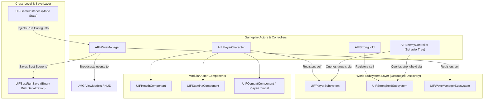
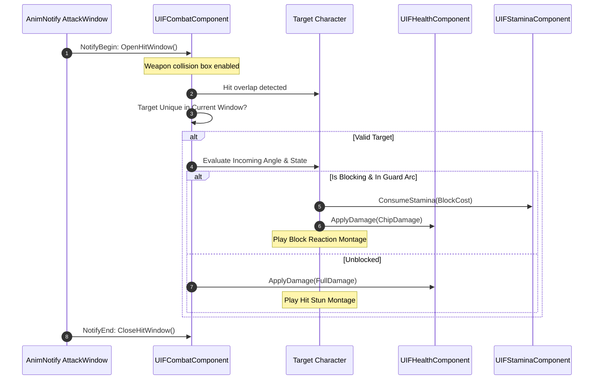

# IronField: Modular C++ Gameplay Architecture & Systems Showcase

[](https://www.unrealengine.com/)
[](https://isocpp.org/)
[](https://www.microsoft.com/windows)
[](https://github.com/abdullahmohieldin/IronField)

A production-oriented **Unreal Engine 5.8 C++ Gameplay Systems and Architecture Showcase**. 

While presented as a third-person wave-defense scenario, **IronField** is fundamentally engineered as an architectural reference implementation demonstrating:
- **Decoupled System Architecture**: Zero hard level-actor references through dynamic `UWorldSubsystem` delegate registries.
- **Component-Driven Combat Pipeline**: State-driven hitscan collision windows, stamina-gated directional mitigation, and chip-damage resolution.
- **Multi-Factor Heuristic AI Targeting**: Mathematical scoring model evaluating distance falloff, aggression bias, target commitment locks, and player retaliation.
- **Queue-Based Wave Spawner & Asset Pre-Warming**: Concurrency-capped spawn scheduling with asynchronous streamable asset pre-loading.
- **Binary State Persistence**: Cross-travel GameInstance caching and robust binary save serialization.
- **Production Shipping Optimization**: Enterprise packaging configuration reducing release payload from **805 MB down to 285 MB** with zero visual degradation and thermal optimization (60 FPS VSync cap).

---

## 🏛️ Architectural Overview



---

## ⚙️ Core Gameplay Systems

### 1. Component-Based Combat & Hit Mitigation Pipeline

The combat system is encapsulated into reusable, single-responsibility Actor Components:
- **`UIFCombatComponent`**: Manages weapon overlap trace volumes, animation-notify hitscan windows (`AnimNotifyState_IFAttackWindow`), and single-target attack hit uniqueness per swing.
- **`UIFPlayerCombatComponent`**: Extends base combat with stamina-governed mechanics:
  - **Combo Chaining**: Buffered attack inputs triggering montage transitions.
  - **Directional Guard**: Validates incoming damage angle against character forward vector. Blocks mitigate base damage, route chip damage to health, and drain stamina. Breaking stamina triggers a heavy guard-break stun montage.
  - **Hold-to-Spin AOE Attack**: Sustained area damage loop with per-target re-hit interval timers and continuous stamina consumption.



---

### 2. Heuristic Multi-Factor AI Target Evaluation

Enemy AI (`AIFEnemyController`) runs an uncoupled Blackboard-driven Behavior Tree. A dedicated execution service (`UIFBTService_FindTarget`) scores candidates (`AIFPlayerCharacter` vs `AIFStronghold`) using a mathematical evaluation formula:

$$\text{FinalScore} = \text{BaseScore} \times \text{AggressionBias} \times \text{CommitmentBonus} \times \text{RetaliationMultiplier}$$

- **Distance Falloff**: Normalized geometric distance curve evaluated identically across candidate targets.
- **Surface-to-Surface Radius Calculation**: Uses `IFCombatTargetingUtils` to compute boundary-to-boundary distance rather than actor pivot points, ensuring consistent melee engagement across varied collision capsule sizes.
- **Target Commitment & Hysteresis Lock**: Prevents target flickering. Current target receives a commitment score bonus, and a switch lock prevents re-targeting unless a challenger exceeds the switch threshold.
- **Retaliation Trigger**: When the player inflicts damage on an enemy, a temporary retaliation multiplier is injected that immediately overrides siege bias.

---

### 3. Asynchronous Wave Director Subsystem

The wave system (`AIFWaveManager`) operates on a time-sliced, event-driven queue:
- **Queue Pacing & Concurrency Throttle**: Waves are flattened into a FIFO spawn queue governed by active enemy concurrency limits, delayed opening graces, and inter-wave breathers.
- **Asynchronous Asset Pre-Warming**: Pre-loads enemy character assets into memory using `FStreamableManager` prior to wave initiation, eliminating mid-combat frame hitches.
- **Dynamic Procedural Scaling (Unlimited Mode)**: In Unlimited Mode, waves scale programmatically using logarithmic and exponential curves for enemy density, health pools, and damage modifiers.

---

### 4. Persistence & State Travel

- **`UIFGameInstance`**: Caches game mode selection (`Normal` vs `Unlimited`) and cross-level state across seamless travel between `MainMenu` and `MainLevel`.
- **`UIFBestRunSave`**: Serializes high-score metrics (cleared waves, total kills) using Unreal's binary `USaveGame` architecture. Includes automated fallback serialization and formatted score projection (`BuildBestText()`).

---

## 🛠️ C++ vs. Blueprint Architectural Boundary

IronField enforces strict architectural discipline across the C++/Blueprint boundary:

| Responsibility Layer | Handled in C++ | Handled in Blueprints |
| :--- | :--- | :--- |
| **State & Logic** | 100% of state machines, damage mitigation math, queue management, cooldowns, timers, and scoring equations. | Zero gameplay math or critical state logic. |
| **References** | Subsystems, interfaces, and delegate broadcasts. | Visual asset binding (Static Meshes, Skeletal Meshes, Materials, Particle Systems). |
| **Animation Driving** | Montage playback requests, notify validation, hit window gating. | Animation Blueprints (`ABP_Player`, `ABP_Melee`), Blendspaces, Inertialization nodes. |
| **Data Tuning** | USTRUCT schemas and base UDataAsset definitions (`UIFEnemyAIData`). | Per-archetype data asset instances (`DA_EnemyAI_Mage`, `DA_EnemyAI_Melee`). |

---

## 🚀 Production Packaging & Size Optimization Benchmark

The project underwent an exhaustive shipping optimization audit, eliminating developer bloat and reducing the retail package by **64.6%**:

| Metric | Unoptimized Baseline | Final Shipping Package | Reduction |
| :--- | :--- | :--- | :--- |
| **Distributable Release Archive** | ~805 MB | **285.14 MB** | **-64.6%** |
| **Total Uncompressed Footprint** | 805.00 MB | **394.35 MB** | **-51.0%** |
| **Cooked Asset Container (`.ucas`)** | 363.24 MB | **201.12 MB** | **-44.6%** |
| **Bulk Texture Data (`UBulk`)** | 314.21 MB | **30.75 MB** | **-90.2%** |
| **Global & Inline Shader Bytecode** | 119.21 MB | **68.74 MB** | **-42.3%** |
| **Debug Symbol Files (`.pdb`)** | 220.68 MB | **0.00 MB (Stripped)** | **-100%** |
| **GPU Power Draw & Temperature** | 97.2W @ 86°C (104+ FPS) | **~30W @ 58°C (60 FPS Locked)** | **Whisper-Quiet** |

### Applied Optimization Techniques:
1. **DeviceProfile Texture Clamping**: Clamped `TEXTUREGROUP_World` to `512` and Characters to `1024` in `DefaultDeviceProfiles.ini`, slashing bulk textures from 314 MB down to 30 MB.
2. **Shader Permutation Pruning**: Stripped redundant D3D11 (SM5) pipelines, Substrate multi-closure BSDFs, and Hardware Ray Tracing shaders.
3. **Unused Runtime Module Removal**: Disabled unused engine plugins (`NNE`, `NNERuntimeORT`, `StateTree`, `GameplayStateTree`), eliminating 35 MB of machine learning DLLs (`DirectML.dll`, `onnxruntime.dll`).
4. **Thermal & Wattage Protection**: Implemented default 60 FPS frame smoothing and VSync in `DefaultEngine.ini` and `DefaultGameUserSettings.ini`.

---

## 📂 Source Code Layout

```text
Source/IronField/
├── AI/
│   ├── BTDecorator_IFHasLineOfSight.cpp/.h      # Throttled raycast line-of-sight checks
│   ├── BTService_IFFindTarget.cpp/.h           # Heuristic multi-factor targeting service
│   ├── IFEnemyController.cpp/.h                # BehaviorTree brain with dynamic subsystem binding
│   └── IFEnemyAIData.h                         # UDataAsset configuration schema
├── Building/
│   └── IFStronghold.cpp/.h                     # Objective actor with subsystem registration
├── Character/
│   ├── IFBaseCharacter.cpp/.h                  # Shared anim/death lifecycle base
│   ├── IFPlayerCharacter.cpp/.h                # Enhanced Input binding, camera, revive logic
│   ├── IFMeleeEnemyCharacter.cpp/.h            # Aggressive melee pawn archetype
│   └── IFMageEnemyCharacter.cpp/.h             # Throttled focus polling, projectile spellcaster
├── Combat/
│   ├── IFCombatComponent.cpp/.h                # Hitscan window tracking & weapon traces
│   ├── IFPlayerCombatComponent.cpp/.h          # Combo buffers, directional block, spin AOE
│   ├── IFCombatTargetingUtils.cpp/.h           # Radii-aware geometric distance equations
│   └── AnimNotifyState_IFAttackWindow.cpp/.h   # Animation notify hit window triggers
├── Core/
│   ├── IFGameMode.cpp/.h                       # Match orchestration & wave win/loss handling
│   ├── IFGameInstance.cpp/.h                   # Cross-travel mode persistence
│   ├── IFPlayerSubsystem.cpp/.h                # World subsystem: Player actor discovery
│   ├── IFStrongholdSubsystem.cpp/.h            # World subsystem: Stronghold actor discovery
│   └── IFPlayerControllerUtils.cpp/.h          # InputMode & widget focus safety guards
├── Stats/
│   ├── IFHealthComponent.cpp/.h                # Health, damage mitigation, revive lifecycle
│   └── IFStaminaComponent.cpp/.h               # Delayed stamina regen & consumption economics
├── UI/
│   ├── IFHUDWidget.cpp/.h                      # Player/Stronghold stat bars & wave info
│   └── IFBestRunSave.cpp/.h                    # Binary USaveGame serialization & formatting
└── Wave/
    ├── IFWaveManager.cpp/.h                    # Concurrency-capped spawn queue & pacing
    └── IFEnemySpawnPoint.cpp/.h                # Position and radius spawn anchors
```

---

## 🕹️ Controls (Enhanced Input)

Mapping Context: `Content/IronField/Input/IMC_Default`

| Action | Binding | Mechanical Behavior |
| :--- | :--- | :--- |
| **Move** | `W`, `A`, `S`, `D` / Left Stick | Camera-relative character displacement |
| **Look** | Mouse / Right Stick | Controller yaw and clamped boom pitch |
| **Jump** | `Space` / Face Button Bottom | Standard physics jump |
| **Sprint** | `Left Shift` (Hold) | Forward movement acceleration; consumes stamina continuously |
| **Attack** | `Left Mouse Button` / Right Trigger | Combo chain window; queued via input buffer |
| **Directional Block** | `Right Mouse Button` (Hold) | Directional damage angle mitigation; chip damage applied on hit |
| **Spin Attack** | `X` (Hold) / Left Face Button | Sustained AOE loop with re-hit interval timer; drains stamina |

---

## 📦 Building & Packaging

### Prerequisites
- **Unreal Engine 5.8**
- **Visual Studio 2022** (v143 toolchain with *Game Development with C++* workload)
- **Windows 10 / 11 64-bit**

### 1. Build from Source
```powershell
git clone https://github.com/abdullahmohieldin/IronField.git
cd IronField
# Generate Visual Studio project files
& "C:\Program Files\Epic Games\UE_5.8\Engine\Build\BatchFiles\GenerateProjectFiles.bat" -project="$PWD\IronField.uproject"
```

### 2. Standalone Shipping Package Build
To generate the optimized release build:
```powershell
& "C:\Program Files\Epic Games\UE_5.8\Engine\Build\BatchFiles\RunUAT.bat" BuildCookRun `
    -project="$PWD\IronField.uproject" `
    -platform=Win64 `
    -clientconfig=Shipping `
    -cook -stage -pak -archive `
    -archivedirectory="$PWD\Builds" `
    -nop4 -utf8output
```

---

## 📄 License
This project's original C++ architecture and systems code are released under the **MIT License**.  
Marketplace assets (meshes, textures, animations) remain the intellectual property of their respective creators and are excluded from git per marketplace licensing agreements.
