# IronField

A modular, production-grade C++ Gameplay Systems & Architecture showcase built in **Unreal Engine 5.8**.

The project demonstrates high-standard systems engineering, component-based composition, pure heuristic AI targeting, decoupled actor discovery, and modular wave management. Core reusable gameplay systems are extracted into an isolated, standalone plugin (`Plugins/IFSystems`) with zero dependencies on concrete game-level actors.

---

## Architecture Overview

```mermaid
graph TD
    subgraph IFSystemsPlugin ["Plugins/IFSystems (Standalone Reusable Systems Module)"]
        direction TB
        subgraph Core ["Core Systems"]
            Registry["UIFActorRegistrySubsystem<br/><i>(Role-keyed singleton discovery & WhenRegistered)</i>"]
            Log["IFLog & IFFeedbackUtils<br/><i>(Centralized category & FX dispatch)</i>"]
        end
        subgraph Stats ["Stats System"]
            Health["UIFHealthComponent<br/><i>(Invincibility, mitigation, death/revive)</i>"]
            Stamina["UIFStaminaComponent<br/><i>(Regen delays, continuous drain, tick-gate)</i>"]
            StatUtils["IFStatUtils<br/><i>(Pure clamped math & percentage calculation)</i>"]
        end
        subgraph Combat ["Combat Pipeline"]
            CombatComp["UIFCombatComponent<br/><i>(Damage scale, hit reactions, defense)</i>"]
            ComboComp["UIFComboCombatComponent<br/><i>(Combo buffering, weapon collision)</i>"]
            Projectile["AIFProjectile<br/><i>(Predictive flight, range decay)</i>"]
            Team["IFTeamTypes & Utilities<br/><i>(IGenericTeamAgentInterface attitude solver)</i>"]
            Notifies["IFAnimNotifies<br/><i>(Attack collision & projectile launch windows)</i>"]
        end
        subgraph Wave ["Wave Infrastructure"]
            Queue["FIFSpawnQueue<br/><i>(O(1) cursor popping & concurrency cap)</i>"]
            Context["FIFSpawnContext & IIFWaveSpawnable<br/><i>(Deferred injection before BeginPlay)</i>"]
            ScaleUtils["IFWaveScalingUtils<br/><i>(Pure wave multiplier math)</i>"]
        end
        subgraph AI ["AI Foundation"]
            Scorer["FIFTargetScoring<br/><i>(Pure stateless targeting scorer & hysteresis)</i>"]
        end
    end

    subgraph IronFieldGame ["Source/IronField (Concrete Game Module)"]
        Characters["AIFBaseCharacter / AIFPlayerCharacter<br/>AIFMeleeEnemyCharacter / AIFMageEnemyCharacter"]
        CombatImpl["UIFPlayerCombatComponent<br/>UIFMeleeCombatComponent / UIFMageCombatComponent"]
        AIImpl["AIFEnemyController & BehaviorTree Services<br/><i>(BTService_IFFindTarget, UIFEnemyAIData)</i>"]
        Director["AIFWaveManager<br/><i>(WarmupComponent, RewardComponent, SpawnPoints)</i>"]
        Environment["AIFStronghold & AIFHealPickup"]
        GameCore["AIFGameMode, UIFGameInstance, UIFHUD, UIFBestRunSave"]
    end

    Characters --> |Derives from & Uses| CombatComp
    Characters --> |Owns| Health
    Characters --> |Owns| Stamina
    Characters --> |Implements| Context
    Characters --> |Implements| Team
    CombatImpl --> |Specializes| ComboComp
    Director --> |Drives| Queue
    Director --> |Uses| ScaleUtils
    Director --> |Registers to| Registry
    AIImpl --> |Evaluates targets via| Scorer
    AIImpl --> |Discovers targets via| Registry
    Environment --> |Registers to| Registry
    Environment --> |Implements| Team
```



---

## Core Systems Breakdown

### 1. Unified Subsystem Actor Registry (`UIFActorRegistrySubsystem`)
- Replaces scattered, singleton-style manager lookups with a single world subsystem keyed by `FName` role (`Player`, `Stronghold`, `WaveManager`).
- **Order Independence (`WhenRegistered`)**: Callers can subscribe either before or after an actor registers. If registered prior, callbacks fire synchronously; if registered after, callbacks execute exactly once upon registration.
- Native C++ lambda overload (`TFunction<void(AActor*)>`) eliminates `UFUNCTION` boilerplate for non-reflected callers.

### 2. Team Attitude & Hostility Matrix (`IGenericTeamAgentInterface`)
- Replaces brittle `Cast<AAIController>` checks with Unreal's standard `IGenericTeamAgentInterface` (`Team 0 = Player/Allies`, `Team 1 = Enemies`, `Team 255 = Neutral`).
- The Stronghold is authored as an allied objective on Team 0, unifying damage filtering and attack targeting under a single, symmetric solver (`IFTeamUtils::SolveAttitude`).

### 3. Component-Based Combat Pipeline & Subobject Safety
- **Subobject Instantiation Safety**: `AIFBaseCharacter` instantiates `CreateDefaultSubobject<UIFCombatComponent>`. Derived characters such as `AIFMageEnemyCharacter` override this via `SetDefaultSubobjectClass<UIFMageCombatComponent>()` without type slicing or engine crashes.
- **`UIFCombatComponent`**: Centralizes hit reaction montage lifecycles, damage intake routing, and `DamageScale`.
- **`UIFComboCombatComponent`**: Specializes melee characters with multi-step attack combos, buffered inputs, and tagged weapon box collision resolution (`IFWeapon` tag preference).

### 4. Self-Contained Stat Components (`UIFHealthComponent`, `UIFStaminaComponent`)
- Zero dependencies on character or pawn classes; operate purely on generic `UActorComponent` contracts.
- **`UIFHealthComponent`**: Clamped mitigation, invincibility windows, single death broadcasting guarantee, and revive mechanics.
- **`UIFStaminaComponent`**: Economics-driven consumption, post-drain regeneration delays (`StaminaRegenDelay`), continuous drain gating, and automatic component tick disabling when fully regenerated.

### 5. Modular Wave Management (`AIFWaveManager`)
- **`FIFSpawnQueue`**: Cursor-based $O(1)$ queue eliminates array shifting allocations and supports runtime concurrency caps.
- **`IIFWaveSpawnable` & `FIFSpawnContext`**: Injects wave difficulty, siege biases, and health/damage scaling factors into spawned pawns via deferred spawning *before* `BeginPlay`.
- Extracted actor components:
  - `UIFWaveWarmupComponent`: Asynchronously pre-warms character meshes and particle assets via `FStreamableManager`.
  - `UIFWaveRewardComponent`: Handles end-of-wave health replenishment and arena pickup spawns.

### 6. Pure Heuristic AI Targeting Scorer (`FIFTargetScoring`)
- Completely decoupled from `UObject` and engine state; 100% deterministic and unit-testable.
- Combines soft monotonic distance falloff ($D(d) = \frac{1}{1 + d/R}$), personality aggression weighting, commitment lock hysteresis, and grudge retaliation multipliers into a stateless calculation.

---

## Extension Guides

### Guide 1: Authoring a New Enemy Archetype (e.g. Rogue / Archer)
You can introduce a new enemy archetype with unique combat mechanics and AI tuning without altering the `IFSystems` plugin or engine source:

1. **C++ (if custom combat behavior is needed)**:
   - Inherit a combat component from `UIFCombatComponent` or `UIFComboCombatComponent` (e.g. `UIFArcherCombatComponent`).
   - Create a character class inheriting from `AIFEnemyCharacter`. In its constructor, call:
     ```cpp
     SetDefaultSubobjectClass<UIFArcherCombatComponent>(AIFBaseCharacter::CombatComponentName);
     ```
2. **Data-Driven AI Balancing**:
   - Create a new `UIFEnemyAIData` DataAsset in Content Browser (e.g. `DA_EnemyAI_Archer`).
   - Tune `PlayerDetectionRange`, `AggressionSpread`, `CommitLockSeconds`, and `DistanceFalloffRange`.
3. **Wave Integration**:
   - Open your authored `FWaveDefinition` in `BP_WaveManager`.
   - Add your new enemy Blueprint to `EnemySpawns`. The wave director will automatically stage, pre-warm, deferred-spawn, and scale the archetype.

### Guide 2: Authoring a New Wave Reward (e.g. Stamina Boost)
Wave rewards are fully componentized:

1. Create a new `UActorComponent` (or Blueprint Component), e.g., `UBP_WaveStaminaRewardComponent`.
2. In `BeginPlay`, fetch `AIFWaveManager` (via `UIFActorRegistrySubsystem::GetActor(IFRegistryRoles::WaveManager)`).
3. Bind to `AIFWaveManager::OnWaveCompleted`.
4. On broadcast, retrieve the player character and apply the stamina buff or spawn custom loot.
5. Attach the component directly to `BP_WaveManager` in the level. No existing spawner or game-loop code needs modification.

---

## Using `IFSystems` in Another Unreal Engine Project

The `Plugins/IFSystems` plugin is fully isolated and ready for drag-and-drop integration into external projects:

1. Copy `Plugins/IFSystems` into your project's `Plugins/` folder.
2. In your `<Project>.uproject`, add:
   ```json
   {
       "Name": "IFSystems",
       "Enabled": true
   }
   ```
3. In your `<Project>.Build.cs`, add `"IFSystems"` to `PublicDependencyModuleNames`:
   ```csharp
   PublicDependencyModuleNames.AddRange(new string[] { "Core", "CoreUObject", "Engine", "IFSystems" });
   ```
4. Attach `UIFHealthComponent`, `UIFStaminaComponent`, or `UIFCombatComponent` to any Actor, or implement `IGenericTeamAgentInterface` to leverage the team hostility system.

---

## Technical Trade-offs & Deliberate Decisions

- **Gameplay Ability System (GAS) vs. Lightweight Custom Components**:
  - *Decision:* For IronField's fast-paced, 3C third-person action scope, full GAS introduces substantial boilerplate, attribute set indirection, and networking setup overhead. Lightweight, dedicated components (`UIFHealthComponent`, `UIFStaminaComponent`, `UIFComboCombatComponent`) provide strict type safety, zero dynamic memory allocations on hot paths, and instant onboarding clarity while maintaining 100% decoupled boundaries.
- **Registry Lifetime**:
  - *Decision:* `UIFActorRegistrySubsystem` is tied to `UWorldSubsystem` rather than `UGameInstanceSubsystem`. This guarantees clean state invalidation and zero cross-level pointer leaks when traveling between Main Menu and Arena maps.
- **Stat Clamping Math**:
  - *Decision:* Pure inline mathematical functions (`IFStatUtils`) isolate math from component lifecycle state, enabling thorough unit-testing without spawning test worlds or actor containers.

---

## Automated Testing & Headless Verification

The codebase includes a comprehensive 12-test suite covering health, stamina, spawn queues, wave math, target scoring, registry ordering, and team hostility.

### Running Headless Automation Tests via CLI
```powershell
& "C:\Program Files\Epic Games\UE_5.8\Engine\Binaries\Win64\UnrealEditor-Cmd.exe" `
    "<ProjectPath>\IronField.uproject" `
    -ExecCmds="Automation RunTests IronField" `
    -TestExit="Automation Test Queue Empty" `
    -stdout -nullrhi -unattended -nopause -NoSplash
```

### Compiling Development Editor & Shipping Targets
```powershell
# Development Editor
& "C:\Program Files\Epic Games\UE_5.8\Engine\Build\BatchFiles\Build.bat" `
    IronFieldEditor Win64 Development `
    -Project="<ProjectPath>\IronField.uproject" -WaitMutex

# Win64 Shipping
& "C:\Program Files\Epic Games\UE_5.8\Engine\Build\BatchFiles\Build.bat" `
    IronField Win64 Shipping `
    -Project="<ProjectPath>\IronField.uproject" -WaitMutex
```

---

## Controls

| Action | Input | Description |
| --- | --- | --- |
| Move | `WASD` / Left Stick | Camera-relative character movement |
| Look | Mouse / Right Stick | Camera rotation and pitch |
| Jump | `Space` | Character jump |
| Sprint | `Shift` (Hold) | Forward movement acceleration; drains stamina |
| Attack | `Left Mouse Button` | Combo attack chain |
| Block | `Right Mouse Button` (Hold) | Directional block; mitigates damage, absorbs hits via stamina |
| Spin Attack | `X` (Hold) | Sustained area attack loop; continuous stamina drain |

---

## Third-Party Notices & Attribution

See [Content/ThirdParty/NOTICE.md](Content/ThirdParty/NOTICE.md) for third-party asset licensing and attribution details regarding potion static meshes, textures, and audio assets.
